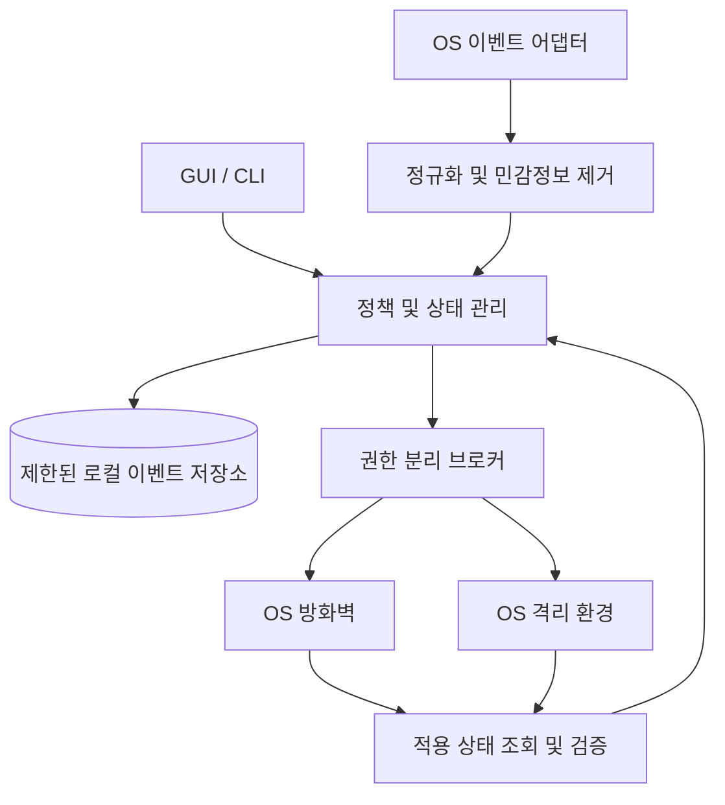

# PrivacyGuard — 제품·기술 명세서 v0.1

작성일 2026-11-25 | 상태: 인터뷰 완료, 설계 초안 | Greenfield, capturedAtCommit: null
PrivacyGuard는 가칭이다. 구현·실환경 검증·라이선스 확정·독립 보안 감사·저장소 생성은 아직 하지 않았다.

## 1. 제품 목표와 성공 조건

사용자가 자기 기기에서 실행되는 소프트웨어에 제공할 개인정보의 범위를 직접 선택하게 한다. 일반 사용자는 이해하기 쉬운 기본 정책, 전문가는 관찰 증거·권한·격리·네트워크의 세부 제어를 얻는다. Windows 우선, 이후 Linux, Android, macOS, iOS/iPadOS를 각각 플랫폼이 허용하는 범위에서 지원한다. 단계적으로 실험판을 공개하고, 실질적 보호 및 복구가 검증되기 전에는 정식 출시하지 않는다.

비목표: 백신 대체, 악성 커널이나 관리자 권한 공격자에 대한 완전 방어, 모든 앱에 동일한 보호 보장, 서비스 제재·안티치트·인증·기기 신뢰 검사를 우회하는 도구, 암호화 통신 강제 복호화, 호스트 하드웨어 식별자 영구 변경. 가상 데이터는 격리된 테스트 환경에서만 검증하며 실제 서비스의 신뢰 검사에 대한 위장 기능을 제품 성공 기준으로 삼지 않는다.

## 2. 사용자 흐름

1. 설치 후 표준 권한으로 실행, 지원 기능·OS 제약·권한을 표시한다. 시스템 감시는 명시적인 선택 후 시작한다.
2. 초기 마법사에서 균형 모드와 로그 보존 설정을 선택한다. 일반 모드는 요약, 전문가 모드는 상세 근거와 정책을 제공한다.
3. 프로그램 목록에서 대상, 관찰된 활동, 보호 범위, 외부 연결을 확인한다. 관찰하지 못한 접근은 안전하다고 표시하지 않는다.
4. 사용자가 정책을 미리 보고 승인한다. 필요한 경우에만 관리자 권한을 요청한다. 실제 적용 결과를 조회하고 시험한다.
5. 격리 실행은 별도 환경에서 시작하며 파일 반출, 네트워크, 공유 폴더, 클립보드 등을 명시적으로 선택한다. 지원되지 않는 앱에는 원인을 설명한다.
6. 일시 중지·정책 수정·긴급 중지·복구·제거를 제공한다. 기존 정책과 원본 파일을 보존한다.

## 3. 기능 요구사항

| ID | 요구사항 | 초기 구현 / 경계 |
|---|---|---|
| FR01 | 프로그램 목록, 실행 상태 및 관찰 가능한 정보 접근 | Windows ETW 등 공식 이벤트; 전체 API 호출 감시는 보장하지 않음 |
| FR02 | 네트워크 연결 및 데이터 사용량 | PID와 시작 시각으로 프로세스 연결; 공유 서비스 귀속 불명 표시; 전송 내용 확인과 구분 |
| FR03 | 위험도 분석 | 관찰 사실, 추론, 미확인을 구분; 민감 경로 접근 자체를 악성으로 단정하지 않음 |
| FR04 | 프로그램별 통신 정책 | OS 방화벽의 제품 소유 규칙만 관리; 적용/되돌리기 검증 |
| FR05 | 도메인·광고·텔레메트리 정책 | DNS 캐시, 공유 IP, 암호화 DNS, VPN 환경의 한계를 표시; 목록의 출처·버전·예외 관리 |
| FR06 | 파일·시스템 격리 및 임시 실행 | 공식 샌드박스 활용; 기본 공유 금지, 승인된 반출, 종료 정리 |
| FR07 | 기기·환경·위치·센서·인증 정보 보호 | OS가 실제로 제공하는 접근 제어 및 격리만 적용; 지원 여부 개별 표시 |
| FR08 | 가상 데이터 제공 | 자체 테스트 앱 및 격리 환경의 합성 데이터로 연구; 실서비스 우회 비목표 |
| FR09 | 보호 프로필 | 호환성, 균형(기본), 엄격, 사용자 정의, 임시; 적용 가능한 기능만 활성화 |
| FR10 | 권한 요청·기억·기간 제한 | OS에서 실제로 중재 가능한 경우만 허용/거부 UI; 불가능하면 관찰·안내 |
| FR11 | GUI, CLI, 트레이, 타임라인, 초기 마법사 | 동일한 정책 서비스; 일반/전문가 모드, 키보드·화면 읽기·한국어/영어, 추가 번역 |
| FR12 | 보호 실패·자동 복구·긴급 중지 | 실제 상태 재조회, 충돌 진단, 제한적 재시도, 사용자 선택, 소유 정책 롤백 |
| FR13 | 로컬 로그·내보내기 | 최소 데이터, 보존 기한, 크기 상한, 삭제 및 민감 경로 마스킹; 사용자 승인 내보내기 |
| FR14 | 자원 관리 | 이벤트 기반, 큐 상한, 집계, 유실 카운터, 저자원 모드 및 성능 표시 |
| FR15 | 선택 온라인 기능 | 기본 꺼짐; 서명된 정책 목록/업데이트, 전송 내역 설명, 회원가입 없음 |
| FR16 | 설치/업데이트/제거 | 서명 지향, 안전한 업데이트·복구, 기존 OS 설정 보존, 제품 소유 규칙만 정리 |

### 정보별 처리 원칙
기기 식별자·OS 환경: 최소 제공 또는 OS 격리; 위치·센서: OS 권한 연동; 파일: 접근 범위 제한 및 선택적 반출; 인증 정보: 원본을 읽거나 저장하지 않고 격리; 통신: 연결 메타데이터와 목적지 정책; 활동 정보: 기본 집계 및 경로 마스킹. 비밀번호, 토큰, 키, 쿠키 값, 화면·키 입력·패킷 본문은 수집하지 않는다. 이미 외부에 제공된 정보는 소급 회수할 수 없다.

## 4. 기술 설계 (제안, 검증 전)

초기 Windows 11 x64, 현재 보안 지원 버전 기준. ARM64 및 추가 Windows 버전은 테스트와 지원 수명 확인 후 추가. C#/.NET LTS + WPF 후보(Windows UI), 공통 정책·계약은 UI 독립. SQLite 후보(로컬 기록), OS 보호 저장소 및 파일 ACL; DB 자체 암호화는 별도 검증 전까지 약속하지 않음. Rust/C++는 병목 또는 필수 네이티브 경계가 확인되기 전에는 추가하지 않는다.

초기에는 단일 일반 권한 프로세스와 필요한 경우에만 실행되는 좁은 권한 브로커를 사용한다. 상시 서비스는 실제 요구가 생긴 뒤 추가한다. 브로커 IPC는 OS ACL, 호출자 확인, 타입화된 명령, 입력 검증 및 작업 범위 제한을 적용하며 임의 셸 명령이나 임의 파일 쓰기는 제공하지 않는다. UI 종료 후 정책의 지속 여부를 명시한다. 관리자 정책·다른 방화벽의 상태를 덮어쓰지 않는다.

### 공통 계약
- AppIdentity: OS, 실행 파일 경로(로컬 전용), 패키지/서명 정보(가능한 경우), 프로세스 ID + 시작 시각. PID나 이름만으로 동일 앱이라 판단하지 않는다. 파일 교체, 경로 이동, 업데이트 시 정책 재검토.
- Observation: 이벤트 ID, 시각, 앱 참조, 분류, 관찰 소스, 결과, 증거 수준, 민감 값 제외, 유실 상태.
- Policy: ID/버전, 앱 범위, 자원 범위, 허용·거부·격리·관찰, 기간, 사용자 승인, OS 기능 요구조건.
- EffectiveState: requested, applied, verified, partial, failed, unsupported, unknown을 구분; 오류·확인 시각·근거·유효 기간 기록.
- OperationJournal: 제품 소유 변경 ID, 기존 상태, 요청 상태, 작업 진행 상태, 롤백 참조; 사용자 비밀값 제외.
- CLI 제안: status, apps, events, policy list/plan/apply/revert, capabilities, diagnostics, sandbox launch. plan은 읽기 전용, 변경은 명시적 명령으로만 수행. 안정적 종료 코드 및 선택 JSON 출력.

### 정책 및 실패 처리
정책 우선순위: OS 및 조직 정책 > 제품 내 명시적 앱별 규칙 > 선택 프로필 > 기본 정책. 지원하지 않는 정책은 적용 성공으로 처리하지 않는다. 균형은 관찰/검증된 제한, 엄격 모드는 필수 보호를 확인하지 못하면 실행 중단 또는 승인 요청, 호환성 모드는 미보호 상태를 표시한다. 사용자 승인 없는 보호 완화 금지. 권한 요청의 타임아웃 기본 거부 또는 사전 정의된 정책; OS가 동기 중재를 지원하지 않으면 요청 기능 자체를 비활성화한다. 이미 전송한 정보는 되돌릴 수 없다.

정책 변경: 계획→승인→적용→OS 상태 재조회→검증 결과 기록. 충돌·프로세스 종료·전원 장애 후 저널을 복구하고 다른 프로그램이 변경한 설정은 덮어쓰지 않는다. 긴급 중지는 제품 소유 변경만 복구하며 조직 보안 규칙은 유지한다. 원본 파일 삭제는 금지; 임시 파일 정리에는 소유 경로 확인, 심볼릭 링크/재분석 지점 검사 및 사용자가 내보낼 데이터에 대한 확인을 포함한다.

## 5. 플랫폼 및 재사용 조사

| 플랫폼 | 우선 활용 | 제약 |
|---|---|---|
| Windows | ETW, Windows Firewall, AppContainer, Windows Sandbox | 이벤트 누락, 앱별 접근 가시성 제한, Sandbox 지원 에디션 및 가상화 필요, 일반 Win32 호환성 미보장 |
| Linux | Flatpak/portals, bubblewrap, 기존 방화벽 | Flatpak 외 앱은 별도 실행 환경; 배포판·권한 차이 |
| Android | OS 권한 안내, 사용자 승인 VpnService | 다른 앱의 임의 시스템 호출을 제어할 수 없음; VPN 충돌 및 배포 정책 검토 |
| macOS | OS 권한 안내, Network/System Extensions | entitlement, 서명 및 승인 필요; App Sandbox는 임의 타사 앱 전체를 통제하지 않음 |
| iOS/iPadOS | 공식 개인정보 설정 안내 및 허용된 네트워크 기능 | 앱 간 강제 격리·정보 가상화 불가; entitlement와 배포 정책 검증 필요 |

참고: Sandboxie core GPLv3, Plus UI custom license 등 구성 요소별 조건; simplewall/OpenSnitch/Portmaster GPL-3.0. 초기에는 외부 소스 복사/재배포 없이 공식 OS 기능을 사용하고 참고 프로젝트는 비교 대상으로 둔다. 직접 결합, 별도 실행 연동, 바이너리 재배포는 각각 라이선스 및 인증 조건 검토. 자체 코드의 후보는 Apache-2.0 또는 GPL-3.0 계열; Q17에 따라 미확정, 공개 코드 배포 전에 확정한다.

## 6. Security Considerations

위협 모델: 과도하게 수집하는 일반 사용자 권한 앱, 악성/변조 정책 파일, 공격적인 앱의 잘못된 귀속, 민감 로그 열람, 로컬 권한 상승, 공급망 변조, 정책 충돌·장애. 관리자/커널 공격자에 대한 완전 보호는 보장하지 않는다.

| 위험 | 수준 | 설계 대응 및 검증 |
|---|---|---|
| 보호 설정과 실제 상태 불일치 | Critical | 기능별 실제 상태 재조회·시험, unknown 표시, 실패 알림 |
| 권한 브로커 악용 | Critical | ACL 및 호출자 검증, 명령 허용 목록, 비인가·교차 사용자 시험 |
| 다른 방화벽 규칙 훼손 | Critical | 소유 ID 및 저널, 기존 정책 보존, 충돌·중단·제거 시험 |
| 민감 로그 유출 | High | 수집 전 마스킹, 제한된 ACL, 보존 상한, 로그/내보내기 비밀 검사 |
| 이벤트 누락/귀속 오류 | High | 큐 제한·유실 감지, PID 재사용/공유 서비스 테스트 |
| 격리에서 호스트 파일 노출 | Critical | 기본 공유 없음, 읽기 전용/명시 반출, 호스트 canary 시험 |
| 업데이트/커뮤니티 정책 변조 | High | 서명, 검증 실패 거부, 스키마 제한, 버전·출처·리뷰, 임의 코드 금지 |
| 도메인 오차/공유 IP | High | 근거 수준 표시, 정책 적용 전 미리보기, DNS/IPv6/VPN 대조 시험 |
| 커널 드라이버 불안정 | Critical | 초기 범위 제외; 서명/HVCI/Driver Verifier/독립 리뷰 통과 전 공개 금지 |

위 표는 이번 문서 작성 중 수행한 자체 설계 위험 분석이다. 독립 Red Team은 미수행이며 기술 검증 전 미해결 상태다. 보안 기능, 서명 검사, Secure Boot 등을 끄도록 요구하지 않는다.

## 7. 성능·데이터 관리 (잠정 목표)

일반 모드 유휴 CPU 평균 1% 이하(15분), GUI 닫은 상태 RSS 100 MiB 이하, 로그 기본 7일/100 MiB 상한(먼저 도달한 조건), 대표 작업 성능 저하 5% 이내, 이벤트 부하에서 큐/메모리 무한 증가 금지. 이 숫자는 요구사항 초안이며 측정값이 아니다. 하드웨어, OS, 샘플링 주기, workload를 기록하고 baseline 대비 반복 측정한다. 유실률, CPU/RAM p95, 로그 쓰기량, 시작 시간도 기록한다. 성능 조절 시 필수 보호는 완화하지 않는다. 오프라인 사용 가능, 자동 통신은 기본 꺼짐, 업데이트 확인 및 정책 공유는 선택.

## 8. 출시 승인 조건

실험판: 읽기 전용 감시, 보호 효과 미보장 명시, 안전한 제거, CI 통과. 정식 1.0: 감시+실제 앱별 통신 정책+복구+기능별 검증 증거, 서명된 빌드·공개 해시/출처 증명, 지원 매트릭스, 도움말, 취약점 신고 채널. 고위험 미해결 결함 없음. 제3자 프로그램의 접근 이유는 공식 문서/관찰 증거가 없으면 추정임을 표시. 격리·드라이버 등 연구 기능은 승인 조건을 별도로 통과하기 전 기본 비활성화. 구체적인 검증 절차는 roadmap 참조.

## Decisions Log

| ID | Topic | Decision | Rationale | Source | Date |
|---|---|---|---|---|---|
| D1 | Q1 목표 | 종합 플랫폼, 쉬운 기능부터 | 단계적 구현 | Interview | 2026-11-25 |
| D2 | Q2 사용자 | 모든 사용자, 일반/전문가 | 접근성과 제어권 | Interview | 2026-11-25 |
| D3 | Q3 기능 | 감시·차단·가상화·네트워크·격리·위험 분석 전체 | 포괄 목표 | Interview | 2026-11-25 |
| D4 | Q4 플랫폼 | Windows 우선, Linux/Android/macOS/iOS 장기 | 단계적 확장 | Interview | 2026-11-25 |
| D5 | Q5 적용 | 지정 앱·실시간 감시·격리·알림·프로필 | 사용자 선택 | Interview | 2026-11-25 |
| D6 | Q6 모드 | 5종 전체, 균형 기본 | 보호와 호환성 | Interview | 2026-11-25 |
| D7 | Q7 정보 | 8개 범주 모두 | 포괄 보호 | Interview | 2026-11-25 |
| D8 | Q8 실패 | 감지·선택·복구·진단·검증·긴급 중지 | 안전성 | Interview | 2026-11-25 |
| D9 | Q9 자체 처리 | 로컬·옵트인 온라인·로그 통제·최소 권한·계정 불필요 | 데이터 최소화 | Interview | 2026-11-25 |
| D10 | Q10 권한 | 일반·필요시 관리자·OS 활용·서비스·선택 드라이버·복구 | 점진적 권한 | Interview | 2026-11-25 |
| D11 | Q11 제어 | 실시간·자동·기억·시간제·설명·취소·권장 | 사용자 선택권 | Interview | 2026-11-25 |
| D12 | Q12 성능 | 저자원·적응형·호환·표시·한도·이벤트·진단 | 실사용성 | Interview | 2026-11-25 |
| D13 | Q13 UX | 대시보드·모드·앱 상세·트레이·CLI·다국어·타임라인·마법사 | 폭넓은 접근성 | Interview | 2026-11-25 |
| D14 | Q14 네트워크 | 감시·통제·목적지·추적차단·분석·OS연동·기록·오프라인 | 외부 통신 통제 | Interview | 2026-11-25 |
| D15 | Q15 출시 | 초기 실험판, 보호 검증 후 정식 | 안전한 공개 | Interview | 2026-11-25 |
| D16 | Q16 충돌 | 사용자 선택 중심 | 보호/호환성 투명성 | Interview | 2026-11-25 |
| D17 | Q17 운영 | 라이선스 유보, 무료/전체 소스/GitHub/서명·재현성/기여/보안감사/광고·강제구독 없음/번역·정책 공유 | 투명성과 지속성 | Interview | 2026-11-25 |

## Dependency Graph & Implementation Order

M0 기초 및 위험 모델 → M1 관찰 → M2 실제 통신 제어 → M3 정책·UX·복구 → M4 Windows 1.0 검증 → M5 격리 강화 → M6 고급 보호 연구 → M7 Linux → M8 Android → M9 macOS → M10 iOS/iPadOS. 각 플랫폼은 자체 capability 매트릭스를 제공하며 이전 단계의 완전한 기능 복제를 요구하지 않는다. 상세 작업과 종료 게이트는 [roadmap-privacyguard.md](roadmap-privacyguard.md).

## 참고 원문
- interview-me: https://github.com/Sorbh/interview-me/blob/main/skills/interview-me/SKILL.md
- ETW: https://learn.microsoft.com/en-us/windows/win32/etw/about-event-tracing
- WFP: https://learn.microsoft.com/en-us/windows/win32/fwp/application-layer-enforcement--ale-
- Windows Firewall: https://learn.microsoft.com/en-us/windows/security/operating-system-security/network-security/windows-firewall/configure
- AppContainer: https://learn.microsoft.com/en-us/windows/win32/secauthz/appcontainer-isolation
- Windows Sandbox: https://learn.microsoft.com/windows/security/application-security/application-isolation/windows-sandbox/windows-sandbox-configure-using-wsb-file
- Sandboxie licenses: https://github.com/sandboxie-plus/Sandboxie/blob/master/LICENSE.Plus
- simplewall: https://github.com/henrypp/simplewall
- Portmaster: https://github.com/safing/portmaster
- OpenSnitch: https://github.com/evilsocket/opensnitch
- Flatpak: https://docs.flatpak.org/en/latest/sandbox-permissions.html
- Android: https://developer.android.com/identity/user-data-ids ; https://developer.android.com/reference/android/net/VpnService
- Apple: https://developer.apple.com/system-extensions/ ; https://support.apple.com/en-ie/guide/security-pdf/sec15bfe098e/1/web/1
- Driver security: https://learn.microsoft.com/en-us/windows-hardware/drivers/driversecurity/driver-security-checklist
- GitHub security: https://docs.github.com/en/code-security/getting-started/github-security-features
